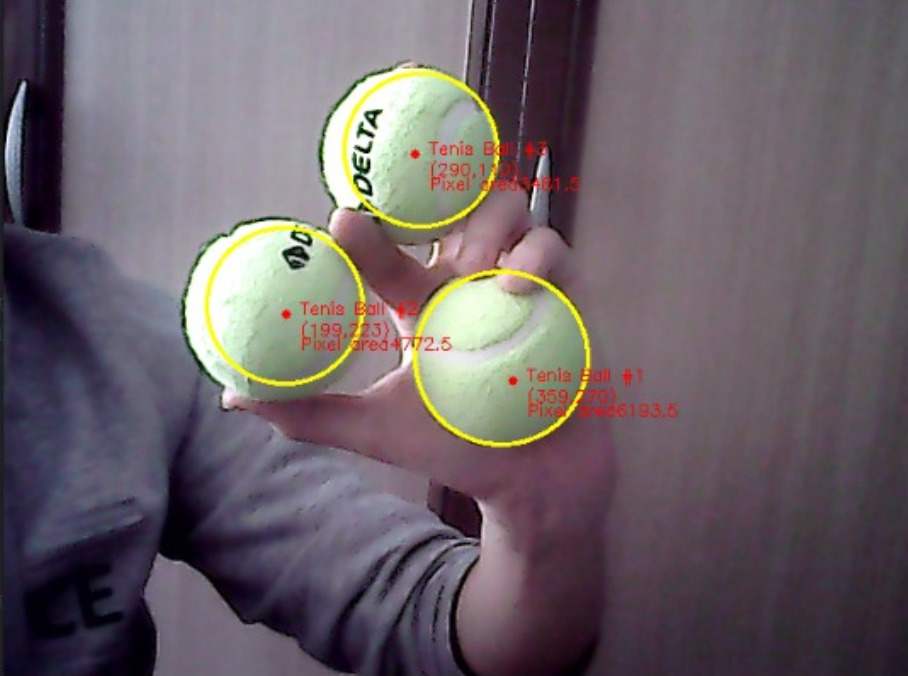
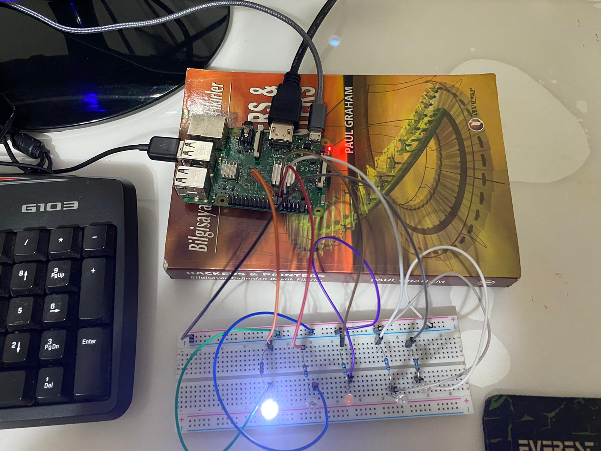

# Tennis Ball Object Detection

Detects and tracks green tennis balls in a webcam feed with OpenCV, controlled from a PyQt5 window, with a Raspberry Pi version that lights one of five LEDs depending on where the balls are. It was a school project: the term project for an object-oriented programming course.

> **Status:** archived. Built in 2021 as a school project. Kept for reference, not maintained.

## What it does

- Finds green balls in every webcam frame: HSV color threshold, morphological open and close, then contours filtered by area (3,000 to 170,000 pixels) and by enclosing-circle radius.
- Draws a circle, the center point, an index, the coordinates and the pixel area of each ball on the live feed. Press `q` to stop.
- A PyQt5 window lets you pick a detector class, start tracking, and show the ball count, the ball coordinates, the centroid and a list of the detected balls.
- Uses the OOP structure the course asked for: an abstract base class `Tennis_ball_detect` with abstract count and coordinate methods, and two subclasses with their own `centroid()`. `Region_number` returns the centers of five vertical regions of the frame, `General_control` returns the centroid of all detected balls.
- The Raspberry Pi version (`raspberrypi/`) finds which of the five vertical regions holds the balls' centroid and turns on the LED for that region through `gpiozero`.



## Raspberry Pi wiring

| LED | GPIO |
| --- | ---- |
| 1   | 17   |
| 2   | 27   |
| 3   | 22   |
| 4   | 23   |
| 5   | 24   |



## Tech stack

- Python 3.8+
- OpenCV (`opencv-python`) and NumPy
- PyQt5 for the interface
- `gpiozero` on the Raspberry Pi

## Running it locally

`requirements.txt` is a full `pip freeze` of the original machine (270 packages, including Ubuntu system packages), so it will not install cleanly. Install only what the code imports:

```bash
pip install opencv-python numpy PyQt5
python3 main.py
```

Run it from the repository root, since the window loads `balls.jpeg` from the current directory. It uses the first webcam (device 0).

On a Raspberry Pi, also install `gpiozero`, wire the LEDs as in the table above, and run `python3 main.py` from inside `raspberrypi/`.

The versions used at the time were opencv-python 4.5.1.48, PyQt5 5.15.2, NumPy 1.19.3 and gpiozero 1.5.1.

## Project structure

- `green_ball_tracker.py`: detector classes for the desktop version
- `main.py`: PyQt5 window
- `raspberrypi/`: the same app with GPIO LED output added to the tracker
- `PROJECT_REPORT.pdf`: the term project report (task requirements, class design, GPIO wiring)
- `balls.jpeg`: the image shown at the top of the app window
- `ss1.jpeg`, `ss2.jpeg`, `1.jpeg`: screenshots and a photo of the Raspberry Pi build

## License

MIT, see [LICENSE](LICENSE).
